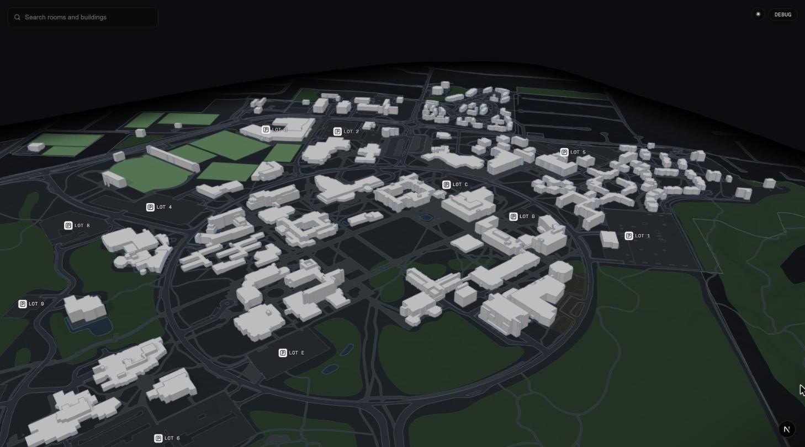
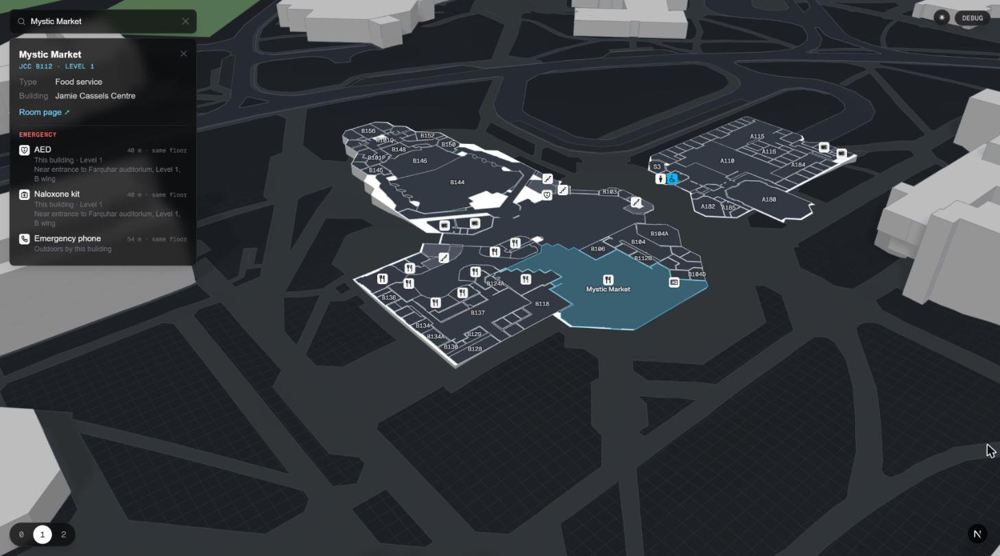
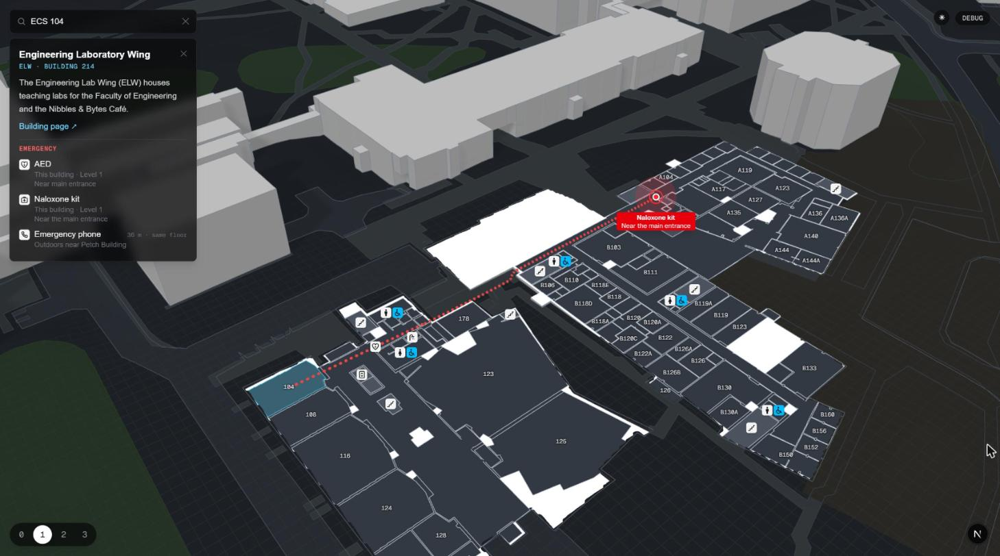
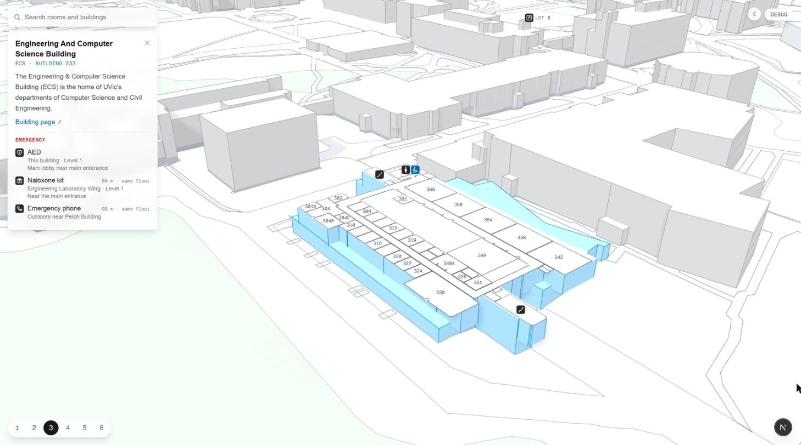

# UVic Better Map

An interactive 3D map of the University of Victoria campus. Real terrain, every building in 3D,
and indoor floor plans you can cut into floor by floor: find a room, see what's on each level,
and get walked to the nearest AED or naloxone kit.



## Features

**Floor plans, inside the 3D model.** Select a building and it's sliced open at its ground floor,
with every room drawn on the floor plate. Step up and down through the levels with the floor
picker (or the number keys). Washrooms (by gender and accessibility), elevators, stairs, food,
AEDs, naloxone kits, showers and microwaves get icons; room names and numbers fill in as you zoom.



**Search.** About 8,000 rooms and every building, by name or number (`ECS 104`, `Mystic Market`).
Picking a result flies to it and opens the right floor.

**Emergency equipment, by walking distance.** Every building and room panel lists the nearest
AED, naloxone kit and emergency phone. Distances are measured along walkable paths, not in a
straight line: corridors indoors (keeping to the middle of them, not cutting through rooms),
OpenStreetMap paths outdoors, in and out through real doors, plus a cost for each flight of
stairs. Click one to see the walk drawn on the map. When the walk crosses to another building,
both floor plans stay open, and you can follow it floor by floor.



**Light and dark themes.** A monochrome look with a single cyan accent, dark by default.



**And more:**

- Terrain from NRCan lidar, with each building's ground floor placed from it. Basements below grade
  are dug out of the ground when you view them.
- Buildings with plans are only as tall as their floors reach. Skyways stay open underneath, and
  courtyards stay open.
- Every view has a link. The address bar keeps the camera, building, floor and room, so you can
  share exactly what's on screen.
- A debug panel (<kbd>`</kbd>) with coordinates, per-building height adjustments and a live theme
  editor.

## Getting started

Requires Node 20 or newer.

```sh
npm install
npm run dev
```

Open <http://localhost:3000>. The built dataset is already in `public/campus`, so no data
build is needed.

### Controls

| | |
| --- | --- |
| Drag / right-drag / scroll | Rotate, pan, zoom |
| Click a building | Select it and open its ground floor |
| Click a room on the shown floor | Select the room |
| <kbd>0</kbd>–<kbd>9</kbd> | Go to that floor of the selected building (<kbd>0</kbd> is the basement) |
| <kbd>`</kbd> | Toggle the debug panel |

### View links

```
http://localhost:3000/#view=camX,camY,camElev,tgtX,tgtY,tgtElev&b=CODE&l=LEVEL&r=ROOM
```

Positions are local metres from the dataset origin and elevations are metres above sea level.
For example, `#b=JCC&l=1&r=JCC+B112` opens Mystic Market.

## How it's built

- [Next.js](https://nextjs.org) and React for the page and panels, with Tailwind for styling.
- [three.js](https://threejs.org) for the scene. `app/campus/campus-viewer.tsx` owns it, in one
  effect.
- Fills on the ground (roads, paths, forest, fields) are real geometry cut along the terrain's own
  triangles, so edges stay sharp at any zoom. Outlines are unioned, so there are no seams between
  shapes.
- Indoor routing (`app/campus/indoor.ts`) runs on a 0.5 m grid of each floor. Outdoor routing
  (`app/campus/walk.ts`) runs on OpenStreetMap's walkable ways.

```
app/
  page.tsx               the one page
  campus/
    campus-viewer.tsx    the 3D scene and its UI
    search.tsx           room and building search
    emergency.tsx        the emergency section of the info panels
    indoor.ts, walk.ts   indoor and outdoor routing
    theme.ts             light and dark themes
    debug-panel.tsx      debug panel and theme editor
public/campus/           the built dataset the app serves
uvic-campus-data/        the data package that builds it
```

## Data

The dataset is built by [`uvic-campus-data`](uvic-campus-data/README.md). That package is
reusable on its own: GeoJSON for every layer, plus a metre-based format for 3D. It pulls:

- **Campus layers and floor plans** from the public ArcGIS layers behind UVic's
  [campus web map](https://experience.arcgis.com/experience/3d2e1b22083940f59f5b6292870e1969).
- **Terrain** from the Natural Resources Canada lidar digital elevation model.
- **Walking paths and building entrances** from OpenStreetMap.

To rebuild it (about 50 s, and it needs network access):

```sh
cd uvic-campus-data
npm install
npm run build                       # writes dist/
cp -r dist/. ../public/campus/
npm run validate -- ../public/campus
```

Build into `dist/` and copy the result over. Building straight into `public/campus` fails while
`next dev` is running.

## Status

This is a work in progress.

- 33 of 106 buildings have floor plans. The rest are footprints at estimated heights.
- Routing is used for emergency equipment so far. General navigation across campus is next.

## Attribution

- Campus data © University of Victoria, from its public ArcGIS services. This is an unofficial
  project, not affiliated with the University.
- Contains information licensed under the
  [Open Government Licence – Canada](https://open.canada.ca/en/open-government-licence-canada)
  (NRCan lidar).
- Map data © [OpenStreetMap contributors](https://www.openstreetmap.org/copyright), available
  under the Open Database License.
